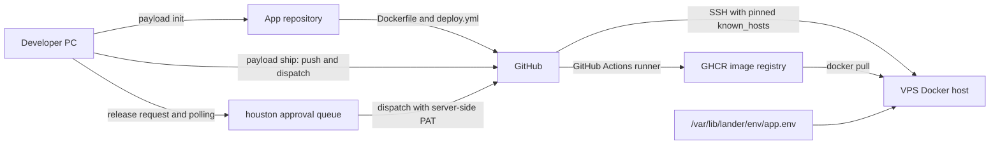
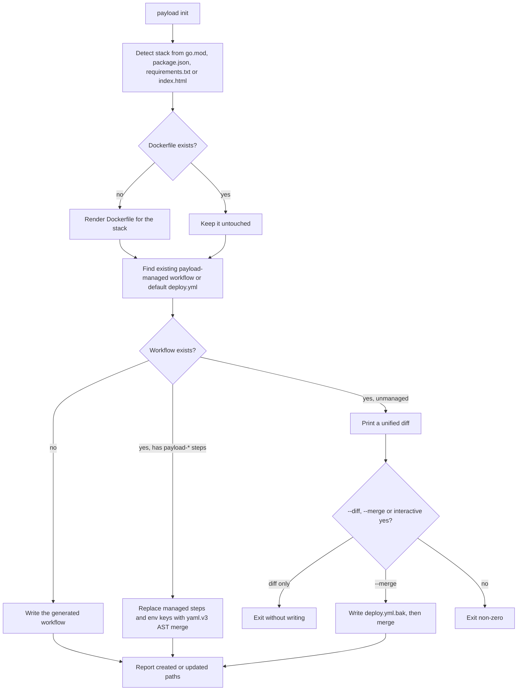
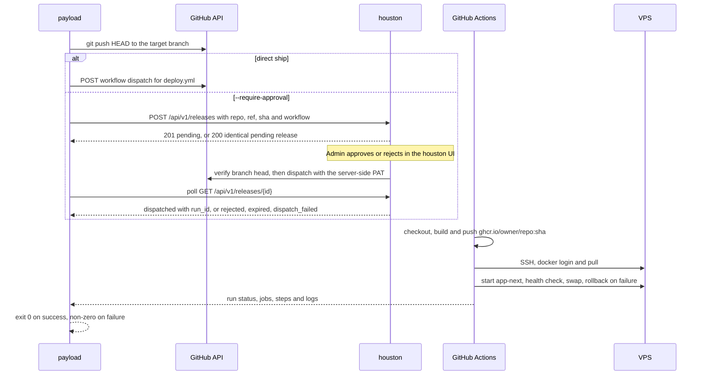

# payload

Deployment CLI for the ORBIT Suite: `payload init` generates a Dockerfile and a GitHub Actions workflow that builds, pushes and ships a container over SSH, while preserving manual edits on re-runs; `payload ship` pushes, dispatches the workflow and streams the run, optionally behind a houston approval.

Part of ORBIT Suite: [lander](https://github.com/yogaagungk/lander) · [blackbox](https://github.com/yogaagungk/blackbox) · [houston](https://github.com/yogaagungk/houston) · [orbit-suite docs](https://github.com/yogaagungk/orbit-suite)

Key features:

- Detects Go, Node, Python or static projects and writes a matching multi-stage `Dockerfile` only when none exists.
- Creates or updates `.github/workflows/deploy.yml` with a YAML AST merge, so custom jobs, steps, triggers, env keys and comments survive; re-running is idempotent.
- Generates a deploy job that pulls the image on the VPS, starts a candidate container on an ephemeral loopback port, health-checks it, then swaps it in with rollback of the previous container on failure.
- `payload ship` pushes the commit, dispatches the workflow and streams run, job, step and log output (TUI or `--plain`).
- `payload ship --require-approval` queues the release in houston and waits for an admin decision before following the dispatched run.

## Problem and where it runs

A repeatable deploy needs four things that are easy to get wrong: a working image, a workflow that does not clobber hand-written CI, a safe zero-downtime swap on the VPS, and a human gate for production. payload generates the first three from the project itself and adds the approval gate without a second deployment system.

payload runs **on the developer's PC or CI runner**, inside the application repository. It talks to GitHub's API and, with `--require-approval`, to a houston instance. The deploy job runs in GitHub Actions and reaches the VPS over SSH; the VPS runs Docker and an optional lander-written env file.

## Architecture



### `init` merge flow



### `ship` with and without approval



## Quick start

Requirements: the Go toolchain pinned in `go.mod`, the `git` CLI, and a GitHub repository with Actions enabled.

```sh
make build       # bin/payload
make test        # go test -race -count=1 ./...
make vet
make lint
make actionlint  # requires actionlint on PATH
make install     # /usr/local/bin/payload
```

Initialize a project:

```sh
payload init --stack go --port 3000 --app orbit-demo --yes
```

Example output (example data):

```text
Initialized payload for orbit-demo (go, port 3000)
  Dockerfile: created Dockerfile
  workflow: .github/workflows/deploy.yml (created/updated)
  next: commit these files and set DEPLOY_* secrets (for example with blackbox sync)
```

Set the required repository secrets, commit, and ship:

```sh
GITHUB_TOKEN=... payload ship --plain
```

Example output (example data):

```text
run 1234567890: https://github.com/example-org/orbit-demo/actions/runs/1234567890
run: in_progress
job deploy: in_progress
  step Validate dispatch inputs: completed
  step Checkout: completed
  step Build and push image: in_progress
[deploy] exporting to image
run: completed
job deploy: completed
run 1234567890 finished: success (https://github.com/example-org/orbit-demo/actions/runs/1234567890)
```

Ship through the approval gate:

```sh
HOUSTON_URL=https://houston.example.com HOUSTON_WEBHOOK_TOKEN=... \
  GITHUB_TOKEN=... payload ship --require-approval --message "Release 1.2.0"
```

Example output (example data):

```text
queued release 4f2c9a1b8d3e7f605a4b2c1d9e8f7a6b (waiting for approval in houston; expires 2026-11-08 10:00 UTC)
release 4f2c9a1b8d3e7f605a4b2c1d9e8f7a6b: approved
release 4f2c9a1b8d3e7f605a4b2c1d9e8f7a6b: dispatched
run 1234567890 finished: success (https://github.com/example-org/orbit-demo/actions/runs/1234567890)
```

Approval mode always streams plain text: if stdout is a terminal, `ship` prints a note and does not start the TUI. The TUI is used only for a direct ship.

Re-run without pushing again, or deploy a specific image tag:

```sh
payload ship --no-push --plain
payload ship --input image_tag=1.2.0 --plain
```

## Usage reference

### `payload init`

| Flag | Default | Purpose |
| --- | --- | --- |
| `--stack` | detect | `go`, `node`, `python` or `static` |
| `--port` | `3000`, `8080` for static | Host port |
| `--app` | directory name | App and container name |
| `--health-path` | `/` | HTTP path used by the post-deploy health check |
| `--dir` | `.` | Project directory |
| `--workflow` | existing managed file or `.github/workflows/deploy.yml` | Workflow path |
| `--yes` | `false` | Use defaults and never prompt |
| `--merge` | `false` | Merge into an existing unmanaged workflow; writes a `.bak` first |
| `--diff` | `false` | Print the proposed diff without writing |

### `payload ship`

| Flag | Default | Purpose |
| --- | --- | --- |
| `--target` | current branch | Branch to push and dispatch |
| `--workflow` | `deploy.yml` | Workflow file name |
| `--repo` | origin remote | Repository as `owner/name` |
| `--api` | `https://api.github.com` | GitHub API base; http only on loopback |
| `--remote` | `origin` | Git remote to push to |
| `--input` | — | `key=value` workflow input, repeatable |
| `--plain` | `false` | Stream plain text instead of the TUI |
| `--no-push` | `false` | Skip `git push`; the ref is already on the remote |
| `--require-approval` | `false` | Queue a houston approval instead of dispatching directly |
| `--houston-url` | `HOUSTON_URL` | houston base URL |
| `--message` | — | Short release note shown in houston |
| `--approval-timeout` | `24h` | Maximum wait for a houston decision |
| `--poll` | `2s` | Status polling interval |
| `--timeout` | `30m` | Maximum wait for the workflow run |

Environment variables:

| Variable | Used by | Purpose |
| --- | --- | --- |
| `GITHUB_TOKEN` | `ship` | PAT with Actions write and Contents read; a classic PAT needs `repo` |
| `HOUSTON_URL` | `ship --require-approval` | houston base URL when `--houston-url` is absent |
| `HOUSTON_WEBHOOK_TOKEN` | `ship --require-approval` | Release webhook bearer token |
| `GIT_AUTHOR_NAME`, `USER` | `ship --require-approval` | Informational `requested_by` value; never used for authorization |

`GITHUB_TOKEN` can also be entered at a hidden prompt on a terminal; it is never accepted as a flag.

### Generated deployment

`init` produces:

- A `Dockerfile` for the detected stack. Go builds with `golang:1.27-alpine` and runs on distroless; Node uses `node:22-alpine` with `npm start`; Python uses `python:3.12-slim` with `python main.py`; static uses `nginx:1.27-alpine`.
- `.github/workflows/deploy.yml` with `push` on `main` and `workflow_dispatch` inputs `image_tag`, `release_id` and `sha`. Managed steps have ids `payload-validate`, `payload-checkout`, `payload-build` and `payload-deploy`.

The deploy job:

1. Validates `image_tag`, app name, ports, health path and env directory in the runner.
2. Builds and pushes `ghcr.io/<owner>/<repo>:<sha>` and `:latest` with `contents: read` and `packages: write`.
3. Writes `DEPLOY_SSH_KEY` to a `0600` file, pins `DEPLOY_KNOWN_HOSTS` and sends values to the VPS on stdin, not in the SSH command line.
4. On the VPS: `docker login ghcr.io`, pull, start `<app>-next` on an ephemeral loopback port, health-check it for up to 30 s, stop/rename the old container and start `<app>` on `127.0.0.1:<port>`. If the final start or health check fails, the previous `-old` container is restarted and the job fails.
5. Loads `/var/lib/lander/env/<app>.env` with `--env-file` when that file exists.

Required repository secrets: `DEPLOY_HOST`, `DEPLOY_USER`, `DEPLOY_PORT`, `DEPLOY_SSH_KEY`, `DEPLOY_KNOWN_HOSTS` (for example via `blackbox sync`).

`workflow_dispatch` accepts `image_tag` for rollback to an earlier image.

## Security notes

- The GitHub token comes from `GITHUB_TOKEN` or a hidden prompt, is checked before the push, and is never written to disk or accepted as a flag.
- `--api` and `--houston-url` must be https; plain http is accepted only on loopback for local tests.
- The deploy job uses `StrictHostKeyChecking=yes` with a pinned `DEPLOY_KNOWN_HOSTS`; the SSH key is written as `0600` only inside the runner.
- Inputs are validated on the runner (image tag, app name, ports, health path, env directory); values then travel on stdin, never in the SSH command line.
- The container runs unprivileged where the base image allows it (Go uses distroless `nonroot`) and binds only to a loopback port on the VPS; the public vhost is lander's.
- Approval is enforced outside payload: houston verifies the branch head before dispatch and uses its own server-side PAT. A payload caller can queue a release but cannot approve it.
- Logs are stripped of terminal control sequences except newlines, tabs and SGR colours; `--plain` is automatic when stdout is not a terminal.

## Troubleshooting

| Symptom | Cause and fix |
| --- | --- |
| `existing workflow .github/workflows/deploy.yml is not payload-managed; review the diff and re-run with --merge` | The file has no `payload-*` steps. Review the printed diff and re-run with `--merge`; a `.bak` is written first. |
| `workflow not merged; re-run with --merge to apply` | You declined the interactive merge prompt. Re-run non-interactively with `--merge`, or use `--diff` for a read-only preview. |
| `unsupported stack "rust" (use go, node, python or static)` | Pass one of the four supported `--stack` values. |
| `cannot detect the stack; pass --stack go\|node\|python\|static` | Add a recognizable project file (`go.mod`, `package.json`, `requirements.txt`, `index.html`) or pass a valid `--stack` value. |
| `app name "My_App" must match ^[a-z0-9][a-z0-9-]{0,62}$` | Use lowercase letters, digits and internal hyphens for `--app`. |
| `port 70000 must be between 1 and 65535` | Fix `--port`. |
| `cannot infer repository from origin remote; pass --repo owner/name` | The origin remote is missing or not a GitHub URL; pass `--repo`. |
| `--houston-url or HOUSTON_URL is required with --require-approval` | Set `HOUSTON_URL` or pass `--houston-url`; also set `HOUSTON_WEBHOOK_TOKEN`. |
| `release <id> rejected`, `expired` or a `dispatch_failed` reason | Exit codes 3, 4 and 5. Check the houston queue; for `dispatch_failed` the reason is shown without secrets. |

## Development

```sh
make test       # go test -race -count=1 ./...
make vet
make lint
make actionlint
```

Layout:

```text
cmd/payload            cobra commands: init, ship, version
internal/config        validation, defaults, app-name derivation
internal/domain        stack and option models
internal/service       Dockerfile templates, stack detection, YAML AST merge, git and GitHub clients, houston client, ship and log streaming
internal/tui           bubbletea ship view
testdata/contract      houston release API fixtures
```
